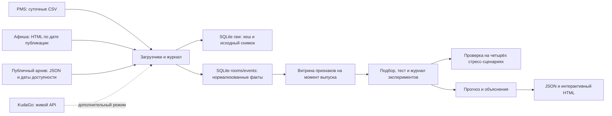

# Горизонт

Семестровый проект НИТУ МИСИС по дисциплине «Интеллектуальный анализ данных». Тема 17: гостиничный бизнес. Прототип прогнозирует загрузку номерного фонда и среднюю цену проданного номера (ADR) на каждый из 14 следующих дней для трёх учебных гостиниц.

## Демонстрация без установки

Откройте `demo/forecast.html` в Edge, Chrome или Firefox. Это интерактивный снимок расчёта на 11.11.2026. В файл встроены два варианта прогноза (учебная и публичная афиши), результаты отложенной проверки и четыре сценария стресс-теста. Можно выбрать гостиницу, дату или показатель, посмотреть объяснение и скачать CSV. Снимок работает без сети; пересчёт с нуля выполняет команда ниже.

## Запуск системы с нуля

Нужны Python 3.11–3.14 и NumPy. Проверено на Python 3.12.14 и NumPy 2.3.5. Из корня проекта:

```powershell
py -3 -m venv .venv
\.venv\Scripts\python.exe -m pip install -r requirements.txt
\.venv\Scripts\python.exe -X utf8 -m hotel.cli demo
```

Откройте в браузере **http://127.0.0.1:8765/**. Процесс сначала собирает данные, обучает модели и генерирует прогноз, затем запускает локальный сервер. Для Linux/macOS используйте `python3` и `.venv/bin/python`. Если команда `py` недоступна на Windows, используйте путь к установленному Python. Локальная обработка не требует сетевых запросов.

Остальные команды ниже приведены для Python с установленным NumPy:

```text
python -X utf8 -m hotel.cli build
python -X utf8 -m hotel.cli serve --port 8765
python -X utf8 -m hotel.cli build --as-of 2026-11-18
python -X utf8 -m hotel.cli build --archive
python -X utf8 -m hotel.cli build --public
python -X utf8 -m hotel.cli replay 7a488d4dd1fb51
python -X utf8 -m hotel.cli replay 8d31b18d19cbb4
python -X utf8 -m unittest discover -s tests -v
```

При повторном `build` журнал фиксирует нулевой прирост порций. При переносе даты догружаются пропущенные дни. Открытый локальный сервер подхватывает новый результат при следующем опросе (до 15 секунд). Используйте `--db`, `--out`, `--config` или `--archive-file` **до** подкоманды, если нужны другие пути. SQLite и результаты по умолчанию лежат в `build/`.

Обычный `build` загружает локальный архив и создаёт оба варианта прогноза. `--archive` выбирает публичный вариант по умолчанию при открытии панели. `--public` пытается получить третий вариант через KudaGo; в режиме с интернетом он доступен дополнительно к локальному архиву. Файл архива и [список источников](docs/public-archive.md) входят в проект.

Пример из PowerShell при активном сервере: `Invoke-RestMethod http://127.0.0.1:8765/health` проверяет доступность, `/api/data` отдаёт структурированный результат. Сервер слушает только loopback.

## Сценарий защиты

1. Откройте «Центр» и «Загрузка». Покажите 28 дней истории, прогноз на 14 дней и дату пикового спроса.
2. Выберите «Публичный архив» и 17 ноября. Покажите ссылки и даты доступности CleanExpo и БИОТ. В разделе источников поставьте последовательно 9, 10 и 11 ноября, чтобы показать момент появления записей.
3. Переключитесь на «Проверка», затем на «Средняя цена». Покажите факт, прогноз, сезонную медиану и ошибку выбранного дня.
4. В «Насколько точен прогноз» сравните четыре метода. В разделе «Стресс-тест» покажите, как меняется разрыв между медианой и Ridge в каждом сценарии.
5. Для технического показа скопируйте ID любого кандидата и выполните `replay ID`. Повторите `build`, чтобы показать нулевой прирост порций; перенесите дату расчёта на неделю, чтобы показать догрузку.

## Архитектура



| Модуль | Назначение |
|---|---|
| `hotel/sources.py` | Суточные симуляторы CSV и HTML, извлечение текста, API KudaGo с повторами запросов |
| `hotel/storage.py` | SQLite, сырой и нормализованный слои, проверки и журнал |
| `hotel/features.py` | Единый расчёт признаков для обучения и прогноза |
| `hotel/models.py` | Два сезонных ориентира, Ridge и градиентный бустинг над деревьями глубины 1 |
| `hotel/pipeline.py` | Временное разбиение, подбор, метрики, прогноз, объяснения, воспроизведение |
| `hotel/stress.py` | Изолированная проверка за пределами исходного теста |
| `hotel/archive.py`, `data/public_events.json` | Разбор локального архива и проверка происхождения |
| `hotel/dashboard.html` | Интерфейс на HTML/CSS/JS/SVG без CDN |
| `tests/test_project.py` | Проверка дат, идемпотентности, восстановления, метрик и объяснений |

## Методика и данные

- Загрузка = 100 × проданные номеро-ночи / доступные номеро-ночи. ADR = выручка за проживание / проданные номеро-ночи. ADR не определена при нуле продаж; повреждённый таргет исключается из обучения и метрик. Исторические признаки заполняются только последними доступными значениями, а при отсутствии истории используются фиксированные априорные значения.
- Офлайн-источники воспроизводимы при seed 17. PMS имитирует суточный CSV-экспорт с пропусками и ошибками, афиша публикует слабоструктурированные HTML-анонсы. Генератор намеренно задаёт недельные, годовые и событийные эффекты. Здесь нет реальных гостиниц или персональных данных.
- Публичный архив состоит из пяти подтверждённых анонсов. Используется дата указанной публикации или дата первого наблюдения, если страница не датирована. Анонсы попадают только в отдельный прогноз, когда были доступны к его выпуску. Дополнительный [API KudaGo](https://docs.kudago.com/api/) в исходной проверке вернул HTTP 403. Основная демонстрация не зависит от API.
- В обучении даты выпуска выбираются с шагом 5 дней, оценка ведётся на восьми непересекающихся 14-дневных окнах в каждом отрезке. Обучающие метки заканчиваются не позднее 01.04.2026; валидация — 02.04–22.07; тест — 23.07–11.11. После подбора на валидации модель переобучается на истории по 22.07, затем фиксируется для теста. Для рабочего прогноза та же спецификация обучается на доступной истории по дате расчёта. Эксперименты фиксируют параметры, seed, хеш исходных данных и версию кода.
- Важность признаков оценивается средним абсолютным вкладом и ростом MAE при перемешивании. Доступны объяснение отдельного прогноза с точным сложением вкладов, сравнение половин теста и частичная зависимость. Отдельный прогон с удалением признаков афиши измеряет их пользу на симуляции.
- Два выбранных дополнительных компонента: интерпретируемость и автоматический подбор с журналом экспериментов. Промышленный мониторинг дрейфа не входит в прототип.
- Сезонная медиана берёт непропущенные значения за четыре одноимённых дня недели, известных на дату выпуска. Если все четыре пропущены, используется простой сезонный ориентир. Эта медиана включена и в признаки обучаемых моделей.
- Стресс-период: **12.11.2026–03.03.2027**, восемь выпусков. Подобранные ранее модели заморожены по 11.11.2026. Сопоставляются четыре сценария: без сдвига, поздние анонсы, снижение событийного эффекта до 35% и совместный сценарий. В режиме задержки 38 из 65 ещё не известных анонсов смещаются до даты за два дня до события. Исторические сведения, даты выпуска и случайный шум остаются общими.

### Проверенный прогон

| Показатель | Модель | MAE Ridge | MAE медианы | RMSE Ridge |
|---|---|---:|---:|---:|
| Загрузка | Ridge (α = 150) | 4,00 п. п. | 9,08 п. п. | 5,54 п. п. |
| ADR | Ridge (α = 1) | 233,86 ₽ | 502,97 ₽ | 313,70 ₽ |

На отложенном синтетическом периоде оценено 335 прогнозов на показатель. На новом стресс-периоде при ослаблении эффекта MAE загрузки у Ridge и медианы составила 5,35 и 5,67 п. п. соответственно. Для применения на реальных данных нужны выгрузки PMS, история снимков афиши и новая валидация.
