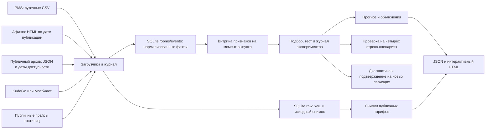

# Горизонт

Семестровый проект НИТУ МИСИС по дисциплине «Интеллектуальный анализ данных». Тема 17 «Гостиничный бизнес». Прототип прогнозирует загрузку номерного фонда и среднюю цену проданного номера (ADR) на 14 дней для трёх учебных гостиниц. При запуске он собирает московскую афишу и опубликованные цены реальных гостиниц.

[Запуск в PyCharm и структура проекта](docs/guide.md).

## Демонстрация без установки

Откройте `demo/forecast.html` в Edge, Chrome или Firefox. Это интерактивный снимок расчёта на 11.11.2026. Встроены учебная и публичная афиши, результаты проверки модели и четыре стресс-сценария. В разделе «Проверка новой схемы» видно, где комбинация Хьюбера и Ridge улучшает прогноз. Снимок работает без сети; пересчёт с нуля выполняет команда ниже.

## Запуск с пересчётом на Windows

1. Установите [Python 3.11–3.14 для Windows](https://www.python.org/downloads/windows/). Для этой сборки проверен Python 3.12. При установке включите доступ к Python из командной строки.
2. Дважды щёлкните по файлу `run-dashboard.cmd` в папке проекта или выполните из неё команду в PowerShell.

```powershell
.\run-dashboard.cmd
```

При первом запуске скрипт создаст `.venv` и скачает NumPy. Затем он загрузит афишу и прайсы, рассчитает прогноз и откроет **http://127.0.0.1:8765/** в браузере. Оставьте окно запуска открытым, пока пользуетесь дашбордом. Для остановки нажмите **Ctrl+C**. После установки NumPy для работы без сети используйте `.\run-dashboard.cmd --archive`.

Для расчёта на другую дату или использования свободного порта:

```powershell
.\run-dashboard.cmd --as-of 2026-11-18 --port 8766
```

Если установлено несколько версий Python, сначала можно явно создать окружение командой `py -3.12 -m venv .venv`. На Linux и macOS используйте `python3 -m venv .venv`, затем `.venv/bin/python -m pip install -r requirements.txt` и `.venv/bin/python -m hotel.cli demo --open-browser`.

## Команды проекта

Для команд ниже используйте Python из окружения. В PowerShell замените `python` на `.\.venv\Scripts\python.exe`, если окружение не активировано.

```text
python -X utf8 -m hotel.cli build
python -X utf8 -m hotel.cli serve --port 8765
python -X utf8 -m hotel.cli build --as-of 2026-11-18
python -X utf8 -m hotel.cli build --archive
python -X utf8 -m hotel.cli build --public
python -X utf8 -m hotel.cli replay 02f5be4ff87edf
python -X utf8 -m hotel.cli replay e525fb0f0a2bcb
python -X utf8 -m unittest discover -s tests -v
```

При повторном `build` журнал фиксирует нулевой прирост порций. При переносе даты догружаются пропущенные дни. Открытый локальный сервер подхватывает новый результат при следующем опросе (до 15 секунд). Используйте `--db`, `--out`, `--config` или `--archive-file` **до** подкоманды, если нужны другие пути. SQLite и результаты по умолчанию лежат в `build/`.

Обычный `build` работает без сети и создаёт варианты прогноза с учебной афишей и публичным архивом. `--archive` открывает публичный архив по умолчанию. `demo` и `build --public` запрашивают KudaGo, затем «Мосбилет» при ошибке или пустом результате. При сбое обоих источников выбирается публичный архив. Эти режимы также собирают прайсы «Таёжного» и «Аструса» и показывают дату каждого снимка. [Происхождение архивной афиши](docs/public-archive.md), [Мосбилет](https://bilet.mos.ru/), [прайс «Таёжного»](https://www.tbhotel.ru/prices/), [прайс «Аструса»](https://astrus.bronhotel.ru/).

При каждом онлайн-запуске обновляется журнал попыток. Одинаковый ответ хранится один раз на источник. Для повторного ответа обновляется время успешной проверки, а журнал показывает ноль новых порций.

Пример из PowerShell при активном сервере: `Invoke-RestMethod http://127.0.0.1:8765/health` проверяет доступность, `/api/data` отдаёт структурированный результат. Сервер слушает только loopback.

## Архитектура



| Модуль | Назначение |
|---|---|
| `hotel/sources.py`, `hotel/live.py` | Суточные симуляторы CSV и HTML, загрузка и переключение источников онлайн-афиши |
| `hotel/rates.py` | Парсинг двух публичных прайсов, метки времени и сохранённые снимки |
| `hotel/storage.py` | SQLite, сырой и нормализованный слои, проверки и журнал |
| `hotel/features.py` | Единый расчёт признаков для обучения и прогноза |
| `hotel/models.py` | Два сезонных ориентира, Ridge, бустинг, Хьюбер и комбинация по горизонту |
| `hotel/pipeline.py` | Временное разбиение, подбор, метрики, прогноз, объяснения, воспроизведение |
| `hotel/stress.py` | Изолированная проверка за пределами исходного теста |
| `hotel/audit.py` | Два новых временных периода, сравнение на одинаковых датах, разбор ошибки и критерий замены |
| `hotel/archive.py`, `data/public_events.json` | Разбор локального архива и проверка происхождения |
| `hotel/dashboard.html`, `dashboard.css`, `dashboard.js` | Разметка, стили и поведение. При сборке объединяются в один автономный HTML |
| `run-dashboard.cmd`, `tools/launch_dashboard.py` | Подготовка окружения и запуск дашборда на Windows |
| `tests/test_project.py` | Проверка дат, идемпотентности, восстановления, метрик и объяснений |

## Методика и данные

- Загрузка = 100 × проданные номеро-ночи / доступные номеро-ночи. ADR = выручка за проживание / проданные номеро-ночи. ADR не определена при нуле продаж; повреждённый таргет исключается из обучения и метрик. Исторические признаки заполняются только последними доступными значениями, а при отсутствии истории используются фиксированные априорные значения.
- Офлайн-источники воспроизводимы при seed 17. PMS имитирует суточный CSV-экспорт с пропусками и ошибками, афиша публикует слабоструктурированные HTML-анонсы. Генератор намеренно задаёт недельные, годовые и событийные эффекты. Здесь нет реальных гостиниц или персональных данных.
- Публичный архив состоит из пяти подтверждённых анонсов. Используется дата указанной публикации или дата первого наблюдения, если страница не датирована. Анонсы попадают в отдельный сценарий прогноза, когда были доступны к его выпуску.
- Публичные тарифы описывают цену предложения. История ADR и загрузки в московском сценарии моделируется. В отдельном эксперименте Ridge с историей и календарём сравнивается с сезонной медианой на данных двух реальных гостиниц Португалии. Методика и результаты приведены в [технической документации](docs/guide.md).
- Обучающие метки для подбора заканчиваются не позднее 01.04.2026; валидация — 02.04–22.07, исходный тест — 23.07–11.11. Финалисты подобраны по MAE на валидации и переобучены по 22.07 перед исходным тестом. Для двух следующих проверок модели обучены только по 11.11.2026 и заморожены. В рабочем прогнозе выбранная схема переобучается на доступной истории по дате расчёта. Журнал хранит параметры, seed, хеш данных и версию.
- Важность признаков оценивается средним абсолютным вкладом и ростом MAE при перемешивании. Доступны объяснение отдельного прогноза с точным сложением вкладов, сравнение половин теста и частичная зависимость. Отдельный прогон с удалением признаков афиши измеряет их пользу на симуляции.
- Два выбранных дополнительных компонента: интерпретируемость и автоматический подбор с журналом экспериментов. Промышленный мониторинг дрейфа не входит в прототип.
- Сезонная медиана берёт непропущенные значения за четыре одноимённых дня недели, известных на дату выпуска. Если все четыре пропущены, используется простой сезонный ориентир. Эта медиана включена и в признаки обучаемых моделей.
- Стресс-период: **12.11.2026–03.03.2027**, восемь выпусков. Подобранные ранее модели заморожены по 11.11.2026. Сопоставляются четыре сценария: без сдвига, поздние анонсы, снижение событийного эффекта до 35% и совместный сценарий. В режиме задержки 38 из 65 ещё не известных анонсов смещаются до даты за два дня до события. Исторические сведения, даты выпуска и случайный шум остаются общими.
- На диагностическом периоде **04.03–23.06.2027** Хьюбер оказался точнее на днях 1–7 по обеим целям и немного хуже в среднем за весь горизонт. Это наблюдение использовано для выбора одной схемы: Хьюбер в первую неделю, Ridge во вторую. В подтверждающем периоде **24.06–08.12.2027** коэффициенты и граница 7 дней заморожены. Схема внедряется отдельно для каждой цели, если MAE ниже, а RMSE выросла не более чем на 5%.

### Проверенный прогон

Подтверждающий синтетический период, 12 выпусков:

| Показатель | MAE Ridge | MAE комбинации | Рабочая модель |
|---|---:|---:|---|
| Загрузка (504 прогноза) | 3,40 п. п. | 3,34 п. п. | Хьюбер 1–7 / Ridge 8–14 |
| ADR (503 прогноза) | 206,54 ₽ | 206,57 ₽ | Ridge |

Для загрузки выигрыш наблюдался в 10 из 12 окон. Статистическая значимость не заявляется. На сценарии ослабленного событийного эффекта новая схема не улучшила Ridge. Для применения на реальных данных нужны выгрузки PMS, история снимков афиши и новая валидация.
