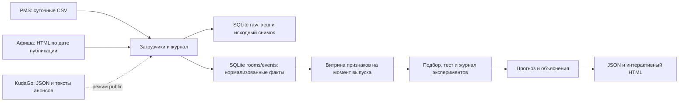

# Горизонт

Семестровый проект НИТУ МИСИС по дисциплине «Интеллектуальный анализ данных». Тема 17: гостиничный бизнес. Прототип прогнозирует загрузку номерного фонда и среднюю цену проданного номера (ADR) на каждый из 14 следующих дней для трёх учебных гостиниц.

## Демонстрация без установки

Откройте `demo/forecast.html` в Edge, Chrome или Firefox. Это интерактивный снимок проверенного расчёта на 11.11.2026: данные и графики встроены в файл. Можно переключать гостиницы, показатели и режимы, выбирать дату, раскрывать вклады признаков и скачивать CSV. Файл работает без сети. Снимок не пересчитывает модели; для расчёта с нуля запустите систему ниже.

## Запуск системы с нуля

Нужны Python 3.11–3.14 и NumPy. Проверено на Python 3.12.14 и NumPy 2.3.5. Из корня проекта:

```powershell
py -3 -m venv .venv
\.venv\Scripts\python.exe -m pip install -r requirements.txt
\.venv\Scripts\python.exe -X utf8 -m hotel.cli demo
```

Откройте в браузере **http://127.0.0.1:8765/**. Процесс сначала собирает данные, обучает модели и генерирует прогноз, затем запускает локальный сервер. Для Linux/macOS используйте `python3` и `.venv/bin/python`. Если команда `py` недоступна на Windows, используйте путь к установленному Python. Локальная обработка не требует сетевых запросов.

Остальные команды ниже приведены для Python с установленным NumPy:

```text
python -X utf8 -m hotel.cli build
python -X utf8 -m hotel.cli serve --port 8765
python -X utf8 -m hotel.cli build --as-of 2026-11-18
python -X utf8 -m hotel.cli build --public
python -X utf8 -m hotel.cli replay 03f50e03ca454c
python -X utf8 -m hotel.cli replay bf798998d9e20e
python -X utf8 -m unittest discover -s tests -v
```

При повторном `build` на ту же дату появляются новые строки журнала с нулём загруженных порций; факты и эксперименты не дублируются. При переносе даты догружаются только пропущенные дни. Если открыт локальный сервер, панель увидит новый результат не позднее следующего опроса (15 секунд). Для планировщика Windows укажите команду `build --public` для ежедневного режима или `build --as-of YYYY-MM-DD` для фиксированного учебного сценария. Используйте `--db`, `--out` и `--config` **до** подкоманды, если нужны другие пути. SQLite и результаты по умолчанию лежат в `build/`.

Пример из PowerShell при активном сервере: `Invoke-RestMethod http://127.0.0.1:8765/health` проверяет доступность, `/api/data` отдаёт структурированный результат. Сервер слушает только loopback.

## Сценарий защиты

1. Откройте «Центр» и «Загрузка». Покажите 28 дней истории, прогноз на 14 дней и дату пикового спроса.
2. Выберите дату на графике или ползунком. Раскройте «Все вклады» и сопоставьте прогноз, сезонный ориентир и известные мероприятия.
3. Переключитесь на «Проверка», затем на «Средняя цена». Покажите факт, прогноз, сезонную базу и ошибку выбранного дня.
4. В разделе «Насколько точен прогноз» покажите таблицу трёх классов моделей и сравнение с вариантом без признаков афиши.
5. В «Какие признаки влияют» сравните два метода важности и две половины теста, затем покажите частичную зависимость.
6. В журнале скопируйте ID любого кандидата и воспроизведите запуск командой `replay ID`. Затем повторите `build` и покажите нулевой прирост порций. Для проверки инкрементальности перенесите дату расчёта вперёд.

## Архитектура



| Модуль | Назначение |
|---|---|
| `hotel/sources.py` | Суточные симуляторы CSV и HTML, извлечение текста, API KudaGo с повторами запросов |
| `hotel/storage.py` | SQLite, сырой и нормализованный слои, проверки и журнал |
| `hotel/features.py` | Единый расчёт признаков для обучения и прогноза |
| `hotel/models.py` | Сезонная база, Ridge и градиентный бустинг над деревьями глубины 1 |
| `hotel/pipeline.py` | Временное разбиение, подбор, метрики, прогноз, объяснения, воспроизведение |
| `hotel/dashboard.html` | Интерфейс на HTML/CSS/JS/SVG без CDN |
| `tests/test_project.py` | Проверка дат, идемпотентности, восстановления, метрик и объяснений |

## Методика и данные

- Загрузка = 100 × проданные номеро-ночи / доступные номеро-ночи. ADR = выручка за проживание / проданные номеро-ночи. ADR не определена при нуле продаж; повреждённый таргет исключается из обучения и метрик. Исторические признаки заполняются только последними доступными значениями, а при отсутствии истории используются фиксированные априорные значения.
- Офлайн-источники воспроизводимы при seed 17. PMS имитирует суточный CSV-экспорт с пропусками и ошибками, афиша публикует слабоструктурированные HTML-анонсы. Генератор намеренно задаёт недельные, годовые и событийные эффекты. Здесь нет реальных гостиниц или персональных данных.
- Дополнительный режим `--public` получает ближайшие московские мероприятия из [API KudaGo](https://docs.kudago.com/api/) и использует их вместо симулированной афиши **только** в новом прогнозе. История и метрики остаются синтетическими. Время доступности события не раньше первого локального снимка. При ошибке API журнал фиксирует сбой и расчёт использует симулированную афишу. Реальная афиша не означает, что прогноз откалиброван на реальных гостиницах.
- В обучении даты выпуска выбираются с шагом 5 дней, оценка ведётся на восьми непересекающихся 14-дневных окнах в каждом отрезке. Обучающие метки заканчиваются не позднее 01.04.2026; валидация — 02.04–22.07; тест — 23.07–11.11. После подбора на валидации модель переобучается на истории по 22.07, затем фиксируется для теста. Для рабочего прогноза та же спецификация обучается на доступной истории по дате расчёта. Эксперименты фиксируют параметры, seed, хеш исходных данных и версию кода.
- Важность признаков оценивается средним абсолютным вкладом и ростом MAE при перемешивании. Доступны объяснение отдельного прогноза с точным сложением вкладов, сравнение половин теста и частичная зависимость. Отдельный прогон с удалением признаков афиши измеряет их пользу на симуляции.
- Два выбранных дополнительных компонента: интерпретируемость и автоматический подбор с журналом экспериментов. Промышленный мониторинг дрейфа не входит в прототип.

### Проверенный прогон

| Показатель | Модель | MAE выбранной | MAE сезонной | RMSE выбранной |
|---|---|---:|---:|---:|
| Загрузка | Ridge (α = 150) | 4,00 п. п. | 11,62 п. п. | 5,54 п. п. |
| ADR | Ridge (α = 1) | 233,63 ₽ | 626,86 ₽ | 313,39 ₽ |

На отложенном синтетическом периоде оценено 335 прогнозов на показатель. Эти числа характеризуют точность на учебном наборе. Для применения на реальных данных нужны фактические выгрузки PMS, архив снимков афиши, новая валидация и оценка рисков для решений по ценам.
